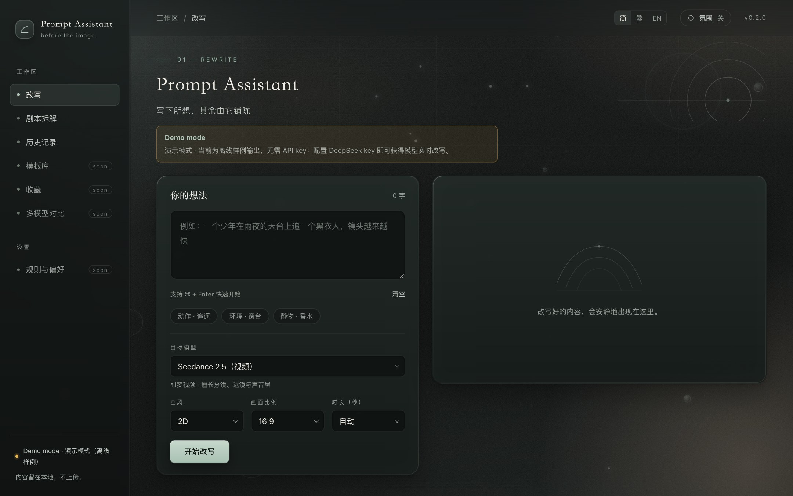
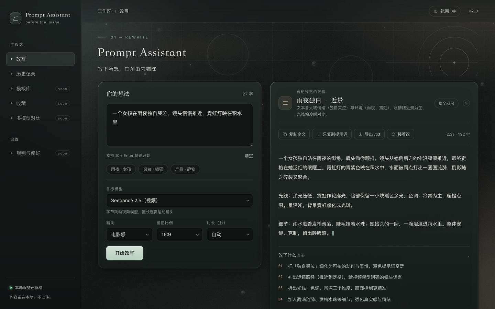
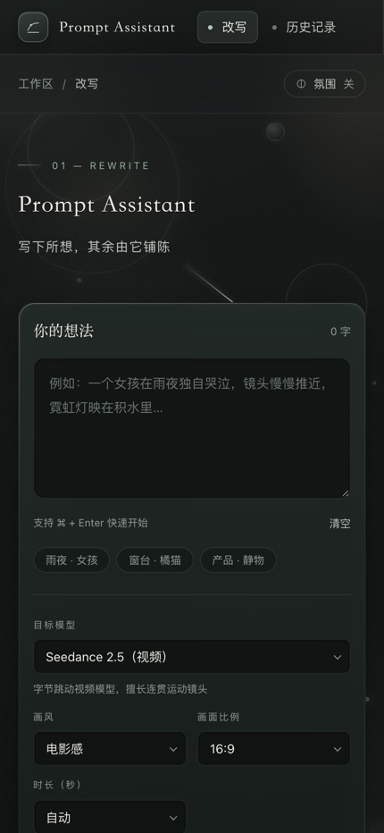

# Prompt Assistant

> 画面之前 · 畫面之前 · Before the image

写下所想，其余由它铺陈

一个本地运行的工作台：把一句模糊的描述整理成模型可用的分镜、光线与细节。戏份由模型推断，不向用户提问；想微调时才用结果区的「换个戏份」。

同时支持 **macOS** 和 **Windows**：两边都有开箱即用的启动入口，自动建环境、引导填 key、清理卡死的旧服务，并在页面真正就绪后才打开浏览器。

支持四个目标模型：Seedance 2.5（视频）、MiniMax H3（视频）、豆包生图 / Seedream（图片）、GPT Image（图片）。改写由 DeepSeek 完成，规则写在 `rules_data.json`。

## English

A local workspace that turns one rough line into a model-ready prompt: shot sizes, camera movement, lighting and sound cues, plus a persistent style lock. The scene type is inferred from what you write — never asked.

Targets Seedance 2.5 and MiniMax H3 (video), Doubao / Seedream and GPT Image (image). Rewriting is done by DeepSeek; the per-model rules live in `rules_data.json` and can be edited without touching code. Everything runs on your machine — the request log and history stay in a local SQLite file. Works on both macOS and Windows, each with a one-click launcher that sets up the environment and opens the browser only when the page is truly ready.

```bash
python3 -m venv .venv && .venv/bin/pip install -r requirements.txt
cp .env.example .env        # 填入 DEEPSEEK_API_KEY
.venv/bin/python -m uvicorn app:app --host 127.0.0.1 --port 8000
```

### 预览



<details>
<summary>更多界面</summary>

结果面板（戏份判定 / 正文 / 改动说明）：



移动端（窄屏单列）：



</details>

| | 一句话简介 | 短句 |
|---|---|---|
| 简中 | 写下所想，其余由它铺陈 | 画面之前 |
| 繁中 | 寫下所想，其餘由它鋪陳 | 畫面之前 |
| EN | Write what you mean — the rest is composed. | Before the image |

产品名 `Prompt Assistant` 三语相同，不翻译。完整文案见 [docs/brand-copy.md](docs/brand-copy.md)。

## 快速开始

要求 Python 3.10+。两个平台都提供一键入口，首次运行会自动建虚拟环境、交互式引导填入并校验 DeepSeek key、清掉卡死的旧服务，并在服务真正能返回完整页面后才打开浏览器（不会白屏）。

### macOS

双击 **`Prompt Assistant.app`**（推荐）——带自定义图标的应用包，图标随仓库分发，双击后自动找到同级的 `run.command` 完成启动。也可以直接双击 `run.command`。

> 从 GitHub 下载的 `.app` 可能带 macOS 的「来自未知开发者」提示：右键 → 打开 → 再点「打开」即可；或终端执行 `xattr -d com.apple.quarantine "Prompt Assistant.app"` 去掉隔离属性。这是所有未签名下载应用的正常现象，不是本项目的问题。

### Windows

1. 双击 **`create-shortcut.cmd`**（只需一次）：在桌面生成带图标的 `Prompt Assistant` 快捷方式；
2. 以后双击桌面图标启动，或直接双击 `run.cmd`。

Windows 下启动逻辑与 macOS 等价：自动检测 `py -3` / `python`、用 `netstat` + `taskkill` 只清理本项目的 uvicorn/python 进程、用 PowerShell 轮询完整首页后才开浏览器。`.ico` 图标与界面同款。

> Windows 无法像 macOS `.app` 那样把「带图标的入口」直接放进 ZIP，所以图标通过一次性的快捷方式脚本落到桌面。若不想创建快捷方式，直接双击 `run.cmd` 也能正常用，只是任务栏显示命令行默认图标。

### 手动安装（任意平台）

```bash
python3 -m venv .venv
.venv/bin/pip install -r requirements.txt      # Windows: .venv\Scripts\pip.exe
cp .env.example .env                           # Windows: copy .env.example .env
# 编辑 .env，把 DEEPSEEK_API_KEY 换成自己的（platform.deepseek.com 获取）
.venv/bin/python -m uvicorn app:app --host 127.0.0.1 --port 8000
```

浏览器打开 <http://localhost:8000>。

## 目录结构

```
Prompt Assistant.app/  macOS 应用包：自带图标，双击转发到 run.command（与项目根目录同级放置）
  Contents/Info.plist       应用元信息与图标引用
  Contents/MacOS/launcher   启动器：定位并调用 run.command
  Contents/Resources/AppIcon.icns  应用图标（1024×1024，随仓库分发）
run.command          macOS 启动脚本：全部启动逻辑（唯一实现）
run.cmd              Windows 启动脚本：与 run.command 等价（唯一实现）
create-shortcut.cmd  Windows 一次性脚本：在桌面生成带图标的快捷方式
PromptAssistant.ico  Windows 图标（16–256px 多尺寸，与界面同款）
app.py               FastAPI 装配（初始化 / 挂路由 / 首页）
config.py            集中配置与环境变量
routes.py            全部 HTTP 接口
llm.py               DeepSeek 客户端（同步 + 流式）
parsing.py           四段标记的状态机解析器
rules.py             规则加载器（按 mtime 热加载）
rules_data.json      知识底座：模型规则、戏份/画风/构图词表
errors.py            上游错误 → 用户可读提示
store.py             sqlite：请求日志 / 结果缓存 / 历史
static/
  index.html         页面骨架（侧栏 + 顶栏 + 可插拔视图）
  css/tokens.css     设计令牌（色阶 / 字阶 / 间距 / 材质令牌）
  css/app.css        布局与组件（固定尺寸基线）
  css/responsive.css 垂直自适应：桌面/笔记本按视口高度 clamp 压紧 padding / 间距 / 最小高度，大屏取上限不变；中等宽度左右栏等分减少参数换行。删掉 link 即回到固定尺寸版
  css/atmosphere.css 材质层：环境光 / 细栅格 / 颗粒 / 卡片景深 / 渐变描边；删掉 index.html 里这条 link 即可整块退回
  css/motion.css     动态层：两团柔光呼吸（13s / 17s）+ 62 个粒子（气泡 / 陨尘 / 流星 / 水波，由 app.js 随机注入）+ 氛围图 Ken Burns 推拉（38s）+ 状态灯呼吸；粒子在文字图层之下，只动 transform/opacity 走 GPU；尊重系统减少动效，删掉 link 即回到全静止
  js/api.js          请求层（SSE / 取消 / 错误归一化）
  js/ui.js           渲染工具（高亮 / 复制 / 图标）
  js/app.js          主逻辑与状态
  backgrounds/       可选氛围背景（默认关闭）
docs/
  brand-copy.md      三语文案规范
  screenshots/       README 预览图（首屏 / 结果 / 移动端）
data/studio.db       自动生成的本地数据库
logs/studio.log      自动生成的运行日志
```

## 接口

| 方法 | 路径 | 说明 |
|---|---|---|
| GET | `/api/health` | 轻量健康检查（返回配置状态）；启动脚本另以「完整首页能否读全」为就绪判据，避免半死服务骗过探测 |
| GET | `/api/options` | 下拉选项、功能开关、可用背景 |
| POST | `/api/stream` | **主接口**，SSE 流式：`start → meta → delta×N → done` |
| POST | `/api/rewrite` | 同步改写，返回 `{scene, reason, prompt, changes[]}` |
| GET | `/api/history?limit=20` | 历史列表 |
| GET / DELETE | `/api/history/{id}` | 详情 / 删除 |
| DELETE | `/api/history` | 清空 |
| POST | `/api/admin/reload` | 热重载规则（仅 `DEV_MODE=1`） |

流式事件里 `meta` 在识别到戏份时立刻发出，`delta` 逐字推送正文，`done` 带完整结构化结果；失败时发 `error`，内容是中文的可操作提示（key 失效、余额不足、限流等），不会把上游原始报文透出。

## 配置

全部在 `.env` 或环境变量里，改配置不用动代码：

| 变量 | 默认值 | 说明 |
|---|---|---|
| `DEEPSEEK_API_KEY` | 必填 | platform.deepseek.com 获取 |
| `DEEPSEEK_MODEL` | `deepseek-chat` | 改写用的文字模型 |
| `DEEPSEEK_BASE_URL` | `https://api.deepseek.com` | 兼容接口可换 |
| `REQUEST_TIMEOUT` | `90` | 上游超时（秒） |
| `MAX_CONCURRENCY` | `2` | 同时最多几个改写请求 |
| `CACHE_TTL` | `86400` | 结果缓存有效期（秒），`0` 关闭 |
| `DEV_MODE` | `0` | 开启规则热重载接口 |

改完 `rules_data.json` 不用重启：加载器按文件 mtime 自动生效。

## dev / prod

- **dev**：`DEV_MODE=1`，改规则即时生效；可以开 `uvicorn --reload` 调 Python 代码。
- **prod**：显式 `--host 127.0.0.1`（默认只本机可访问）、`DEV_MODE=0`、`.env` 权限 600。上游错误只给中文提示，完整堆栈写在 `logs/studio.log`。

## 加新功能

页面已经是「侧栏 + 顶栏 + 视图」的壳：

1. 在 `index.html` 里加一个 `<section class="view" id="view-xxx">`；
2. 在侧栏加一条 `<button class="nav-item" data-view="xxx">`；
3. 新模块的 JS 放到 `static/js/`，复用 `api.js` / `ui.js`；
4. 后端在 `routes.py` 里加路由，数据层复用 `store.py`。

侧栏里标 `soon` 的项（模板库 / 收藏 / 多模型对比 / 规则与偏好）就是预留的位置。

## 验证

```bash
curl http://localhost:8000/api/health
curl -X POST http://localhost:8000/api/rewrite \
  -H 'Content-Type: application/json' \
  -d '{"prompt":"一只橘猫趴在窗台上看雪","model":"gpt-image","style":"3D","ratio":"9:16"}'
```

流式接口用 `curl -N -X POST .../api/stream` 看事件序列。回归时覆盖：空提示词、未知模型、四个模型 × 两种比例、缓存命中、历史读写，以及断网 / 错 key / 429 三类错误分支。

## 已知局限

- 改写质量取决于 `rules_data.json` 的规则与 DeepSeek 本身。
- 流式下四段标记靠状态机切分；若模型完全不按格式输出，解析器会把整段当提示词，不丢内容但会缺少戏份与改动说明。
- 数据库和日志都在项目目录里，尚未做多用户与备份。

## License

MIT — 见 [LICENSE](LICENSE)。
